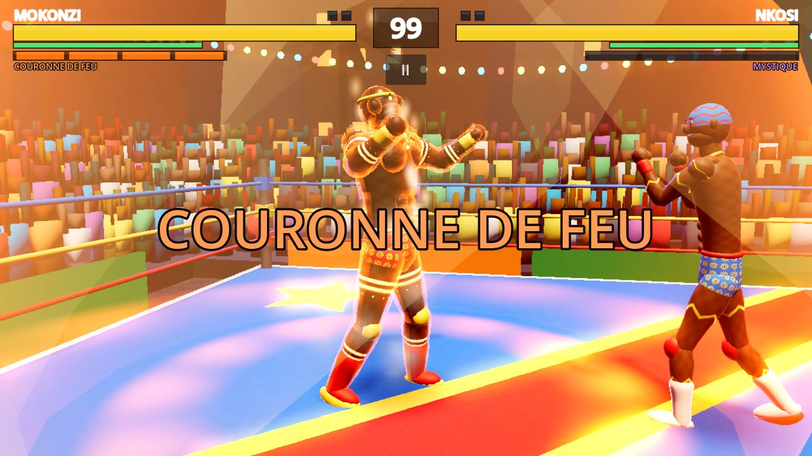
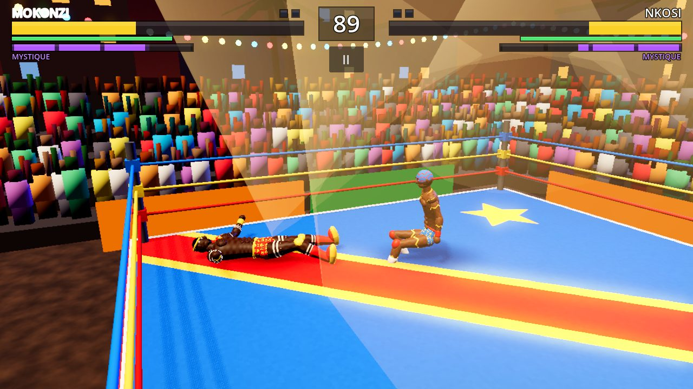
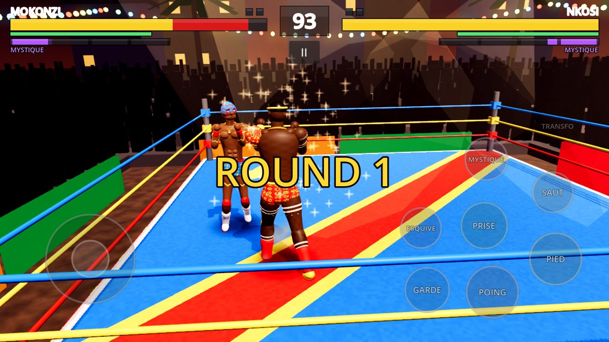
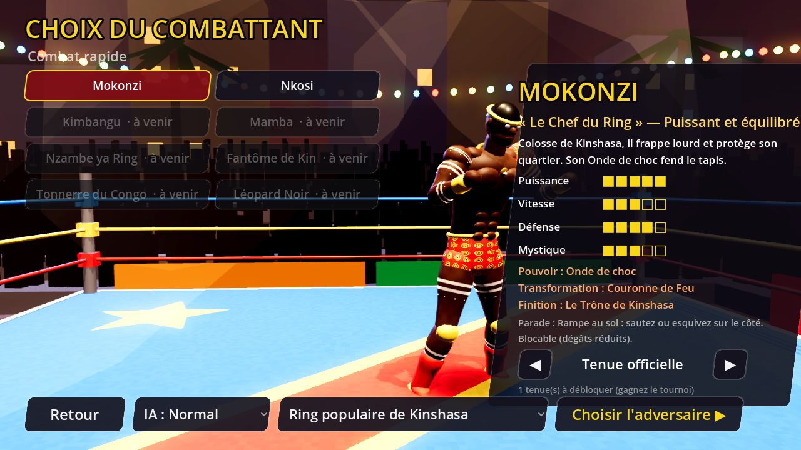

# Catch 243 — le catch congolais en 3D

Jeu de combat / catch **100 % original** en 3D pour Android, réalisé avec **Godot 4.4** et **GDScript**.
Mécaniques de combat inspirées des jeux de combat 3D (frame data, enchaînements, pas de côté),
mise en scène spectaculaire (finitions sans gore), pouvoirs mystiques et transformations,
le tout dans l'univers du catch populaire de Kinshasa.

> Aucun personnage, animation, musique ou ressource d'un jeu existant n'est utilisé.
> Modèles, animations, textures, sons et musique sont **générés par le code** du projet.

## 📱 Télécharger l'APK de test

**[⬇️ catch243-v0.1.0-arm64.apk](apk/catch243-v0.1.0-arm64.apk?raw=1)** (26 Mo, Android 5.0+, téléphones 64 bits ARM)

Installation : télécharger le fichier sur le téléphone, l'ouvrir, puis autoriser
« Installer des applications inconnues » pour le navigateur ou le gestionnaire de fichiers.
Il s'agit d'une version de test signée avec une clé de debug.

Version actuelle : **0.1.0 — premier prototype jouable** (voir [`docs/RAPPORT_PROTOTYPE.md`](docs/RAPPORT_PROTOTYPE.md)).

## Contenu du prototype

| Élément demandé | État |
|---|---|
| 2 combattants 3D (Mokonzi, Nkosi) | ✅ modèles articulés procéduraux, 3 tenues chacun |
| Arène : ring populaire de Kinshasa | ✅ ring aux couleurs du drapeau, foule animée, guirlandes, portique |
| Caméra dynamique | ✅ suivi, distance adaptative, recentrage en prise, plans cinématiques, ralentis |
| Commandes tactiles | ✅ joystick flottant + 8 boutons multi-touch, vibrations |
| Déplacements 3D | ✅ avant/arrière, pas de côté, saut, esquive |
| Coups de poing / pied | ✅ chaînes (Direct → Crochet → Uppercut, etc.), coups lourds, aériens |
| Une prise de catch | ✅ Body Slam de Kin (animations synchronisées des deux corps) |
| Une projection | ✅ Projection du Fleuve |
| Une technique mystique | ✅ Onde de choc (Mokonzi), Éclair mystique (Nkosi) |
| Une transformation | ✅ Couronne de Feu / Esprit de l'Orage (shader d'aura, yeux, particules, +puissance/+vitesse) |
| IA simple | ✅ 4 niveaux (Facile, Normal, Difficile, Maître) |
| Victoire / défaite | ✅ manches, chrono, K.O., tombé (1-2-3), temps écoulé, écran de résultats |
| Bonus | garde, contre (parade), contre-attaque après esquive, immobilisation, ultime + technique de finition, entraînement, tournoi, survie, déblocage de tenues |
| APK de test | ✅ [`apk/catch243-v0.1.0-arm64.apk`](apk/catch243-v0.1.0-arm64.apk?raw=1) (arm64-v8a, signé debug) |

## Lancer le projet

1. Installer **Godot 4.4.x** (version standard, pas .NET).
2. Ouvrir `project.godot`, puis F5.

Ligne de commande :

```bash
godot --path .                          # jouer
godot --headless --path . -- --selftest # combats IA vs IA sans rendu + validation des données
godot --path . -- --benchmark 30        # mesure FPS / temps de frame / draw calls (30 s)
godot --path . -- --shot=fight --advance=240 --out=capture.png   # capture d'écran
```

## Commandes

| Action | Tactile | Clavier | Manette |
|---|---|---|---|
| Déplacement / pas de côté | Joystick (gauche de l'écran) | WASD / ZQSD / flèches | Stick gauche |
| Poing | POING | J | X |
| Pied | PIED | K | Y |
| Prise (+ direction = projection, sur adversaire au sol = tombé) | PRISE | L | B |
| Garde (maintenir ; au moment de l'impact = contre) | GARDE | I / Maj | RB |
| Esquive (invulnérable, ouvre une contre-attaque) | ESQUIVE | U | LB |
| Saut (+ poing/pied = attaque aérienne) | SAUT | Espace | A |
| Pouvoir mystique | MYSTIQUE | O | RT |
| Transformation / Ultime | TRANSFO / ULTIME | P | LT |
| Pause | II | Échap | Start |
| Afficher hitboxes | (options) | F3 | — |

## Export Android

Le fichier `export_presets.cfg` contient deux préréglages :

- **Android APK arm64** (debug, publié dans `apk/`) : `godot --headless --path . --export-debug "Android APK arm64" apk/catch243-v0.1.0-arm64.apk`
- **Android APK** (debug universel arm64 + armv7, 52 Mo, non versionné) : `godot --headless --path . --export-debug "Android APK" build/catch243-debug.apk`
- **Android AAB** (release, build Gradle) :
  `godot --headless --path . --install-android-build-template --export-release "Android AAB" build/catch243-release.aab`
  avec le keystore de release fourni par variables d'environnement
  (`GODOT_ANDROID_KEYSTORE_RELEASE_PATH`, `..._USER`, `..._PASSWORD`). Aucun keystore n'est versionné.

Prérequis : modèles d'export Godot 4.4.1, Android SDK (platform-tools, build-tools 34, platform 34), JDK 17+.

## Architecture

Voir [`docs/ARCHITECTURE.md`](docs/ARCHITECTURE.md). En résumé :

```
scripts/
  autoload/   Settings (profils graphiques, FPS), Game (modes, progression), Sfx (audio synthétisé)
  data/       MoveData, PowerData, FighterData  — ressources de données pures
  fighters/   un script par combattant + Roster (registre) + BaseMoves
  combat/     Fighter (machine à états 60 Hz), Match (arbitre), GrabLib, Projectile, FighterCmd
  ai/         FighterAI (4 niveaux, perception retardée)
  visual/     FighterRig (modèle + animation), AnimLib (poses clés), MeshFactory, Vfx (pooling)
  arena/      ArenaBase, KinshasaRing
  camera/     FightCamera
  ui/         HUD, TouchControls, PlayerInput, thème, acteur de prévisualisation
shaders/      peau + peintures corporelles, tissu wax, aura, foule instanciée, tapis, effets
```

La logique de combat (`combat/`) ne dépend jamais du rendu : `Match.step()` peut tourner sans
aucun nœud visuel (c'est ce que fait `--selftest`).

## Captures (rendu logiciel, sans GPU)

| Transformation « Couronne de Feu » (renderer Mobile/Vulkan) | Combat (renderer Mobile/Vulkan) |
|---|---|
|  |  |
| **Commandes tactiles (renderer Compatibility)** | **Sélection du combattant** |
|  |  |
